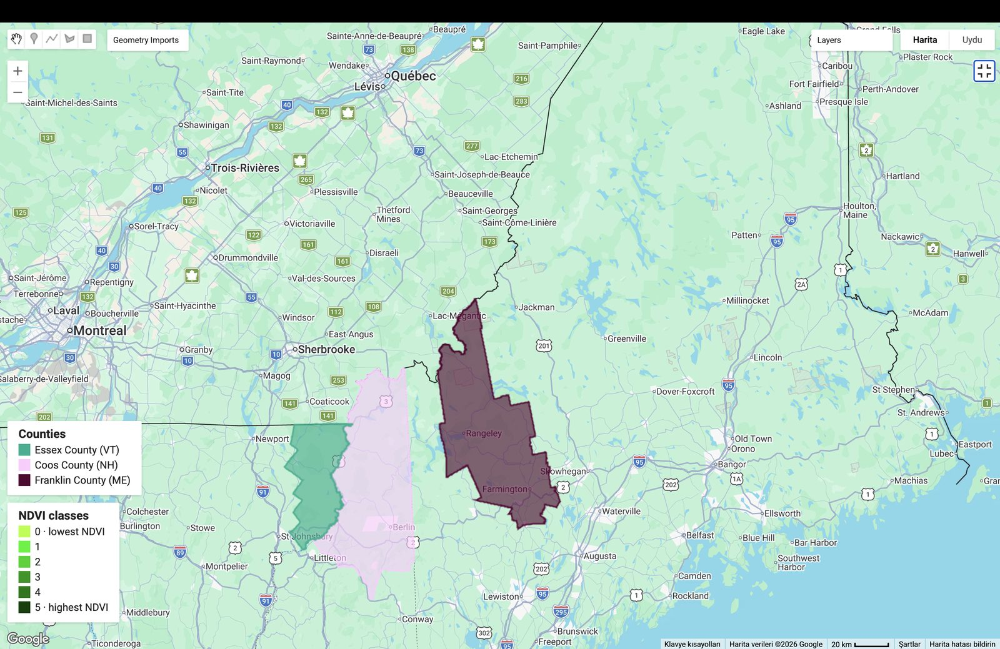
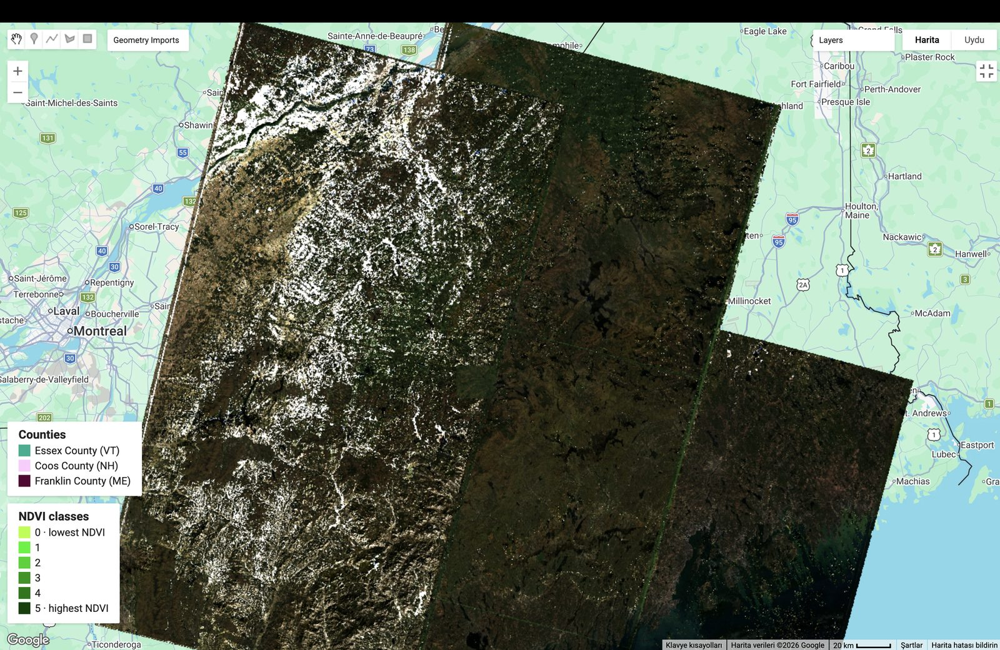
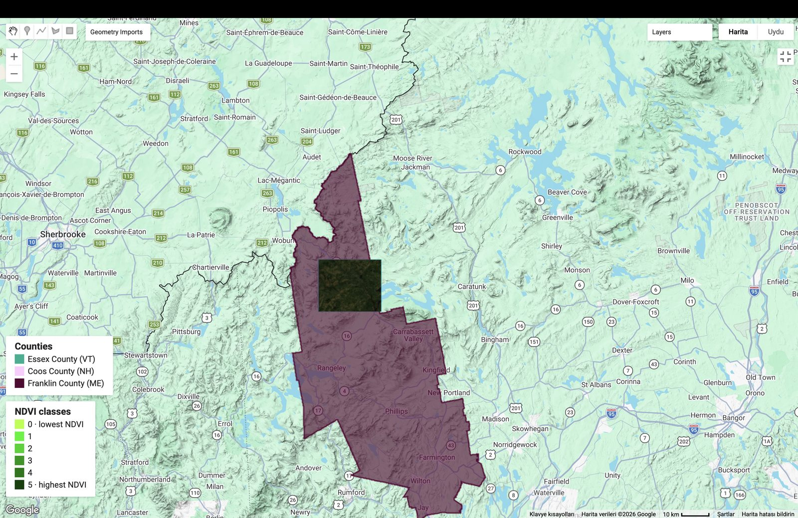
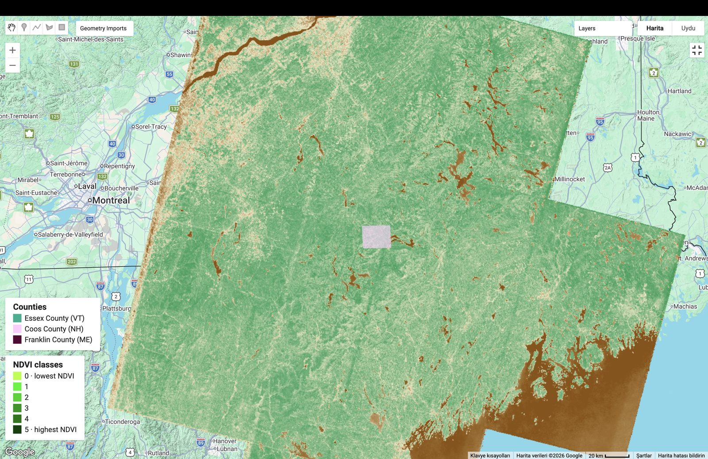
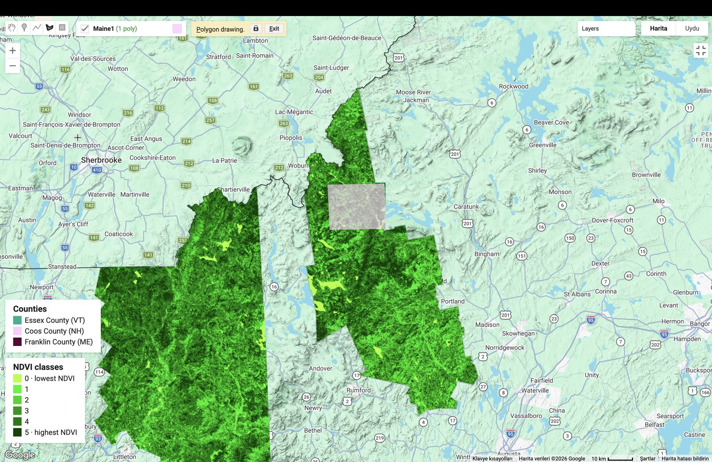
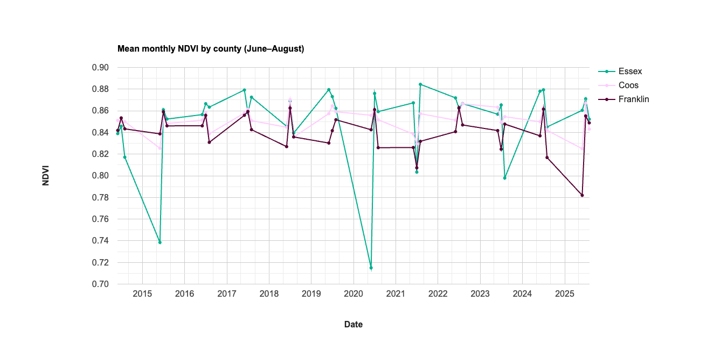
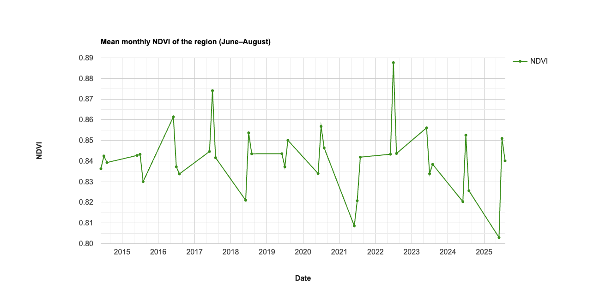

# Atelier GEE NDVI

*English: [README.md](README.md)*

Atelier d'introduction à Google Earth Engine : de l'image satellite brute à une carte de santé de la végétation, avec classification et séries temporelles. Script prêt à l'emploi, guide pas à pas interactif (FR / EN / TR), et notes sur les améliorations apportées par rapport au matériel d'atelier d'origine.

**Guide interactif :** [Français](docs/guide-fr.html) · [English](docs/index.html) · [Türkçe](docs/guide-tr.html)  
*(publiable avec GitHub Pages — voir plus bas)*

## Contenu

| Chemin | Description |
|---|---|
| [`scripts/ndvi_workshop.js`](scripts/ndvi_workshop.js) | Script complet — à coller dans le Code Editor de GEE |
| [`docs/guide-fr.html`](docs/guide-fr.html) | Guide pas à pas avec schémas ([EN](docs/index.html), [TR](docs/guide-tr.html)) |
| [`docs/improvements.fr.md`](docs/improvements.fr.md) | Ce que nous avons amélioré ([EN](docs/improvements.md)) |
| [`images/`](images/) | Captures d'écran des résultats (voir la galerie) |

## Objectifs

1. Interagir avec l'API de Google Earth Engine en JavaScript.
2. Calculer de nouvelles bandes (NDVI), classer une image et produire des graphiques.
3. Comprendre les intérêts et les limites de ces données et méthodes.

## Déroulé

Zone d'étude : trois comtés forestiers du nord-est des États-Unis (Franklin – Maine, Coos – New Hampshire, Essex – Vermont).

1. **Géométries** : point, polygone, sélection de comtés dans `TIGER/2018/Counties`.
2. **Collection Landsat 8** (C2 L2, 2014–2025) filtrée par date et par emprise.
3. **Masque nuages / ombres** via les bits 3 et 4 de `QA_PIXEL`.
4. **Mise à l'échelle** des valeurs brutes (DN) en réflectance de surface.
5. **NDVI** pour chaque image, puis composite médian.
6. **Classification K-Means** (6 classes), renumérotées selon le NDVI moyen.
7. **Séries temporelles** du NDVI moyen mensuel d'été (juin–août) par comté.
8. **Export** GeoTIFF et shapefile vers Google Drive, puis mise en forme dans QGIS.

## Galerie de résultats

Résultats obtenus en lançant [`scripts/ndvi_workshop.js`](scripts/ndvi_workshop.js) dans le Code Editor de GEE.

**Zone d'étude** — Franklin (ME), Coos (NH), Essex (VT)

**Composite Landsat en vraies couleurs** (collection / région)

**NDVI médian**

**Classes K-Means** (0 = NDVI le plus faible → 5 = le plus élevé)

**Séries temporelles NDVI d'été** (juin–août, par comté)

## Prérequis

- Un compte [Google Earth Engine](https://earthengine.google.com/) associé à un projet Google Cloud (gratuit pour un usage non commercial).
- QGIS 3.x pour la dernière partie (facultatif).
- Aucune connaissance préalable de JavaScript n'est nécessaire.

## Utilisation

1. Ouvrir le [Code Editor](https://code.earthengine.google.com/).
2. Coller le contenu de `scripts/ndvi_workshop.js` et cliquer sur **Run**.
3. Pour les exports : onglet **Tasks**, puis **Run** sur chaque tâche. Les fichiers arrivent dans le dossier Drive `GEE_NDVI_workshop` (modifiable en haut de la section 7 du script).

> Si l'export échoue avec `Permission denied to create object in folder`, un dossier Drive partagé en lecture seule porte le même nom. Choisir un nom de dossier unique.

## Points clés

- Les produits Level-2 doivent être **mis à l'échelle** avant tout calcul d'indice : un NDVI calculé sur des DN est biaisé par le décalage de −0,2.
- La **médiane** temporelle résiste mieux que la moyenne aux nuages résiduels.
- Le choix du **réducteur** change l'interprétation : moyenne pour l'état général d'une zone, maximum pour son seul pixel extrême.
- Les numéros de classes **K-Means** sont arbitraires : il faut les ordonner avant de les représenter avec une palette ordonnée.
- `Export.image` attend une seule image. Le paramètre `folder` est un **nom** de dossier Drive, pas un chemin.

## Publier le guide avec GitHub Pages

Dans le dépôt : **Settings → Pages → Build and deployment**, source **Deploy from a branch**, branche `main`, dossier `/docs`. Le guide anglais s'ouvre à `https://geobytebrew.github.io/GEE_NDVI_workshop/`, le guide français à `…/guide-fr.html`.

## Crédits

Structure et code d'origine : atelier Women in GIS « Intro to Google Earth Engine – Utilizing GEE to Analyze NDVI » (15/10/2026). Raffinements du script, guide interactif et documentation : Irem Cagbayir.

Données : USGS Landsat 8 Collection 2 Level-2 ; US Census Bureau TIGER/Line 2018, via Google Earth Engine.
