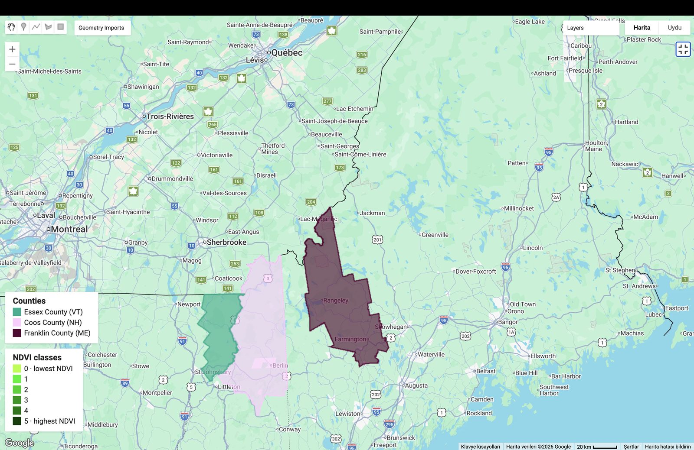
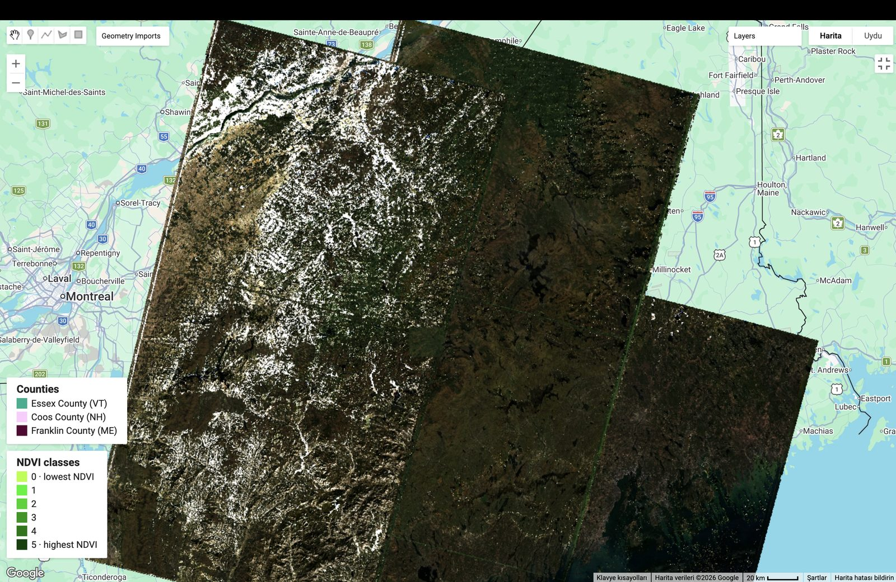
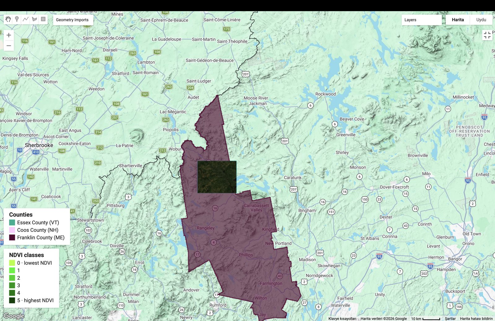
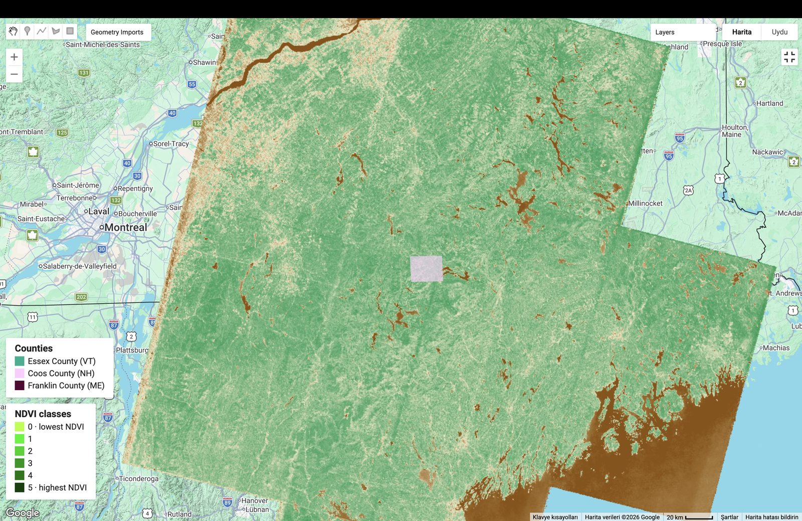
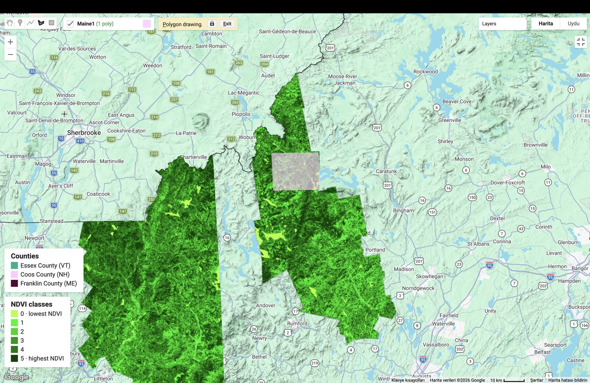
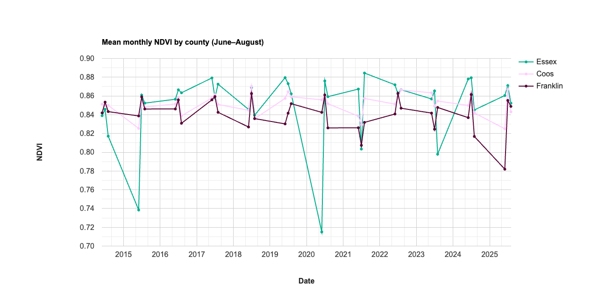
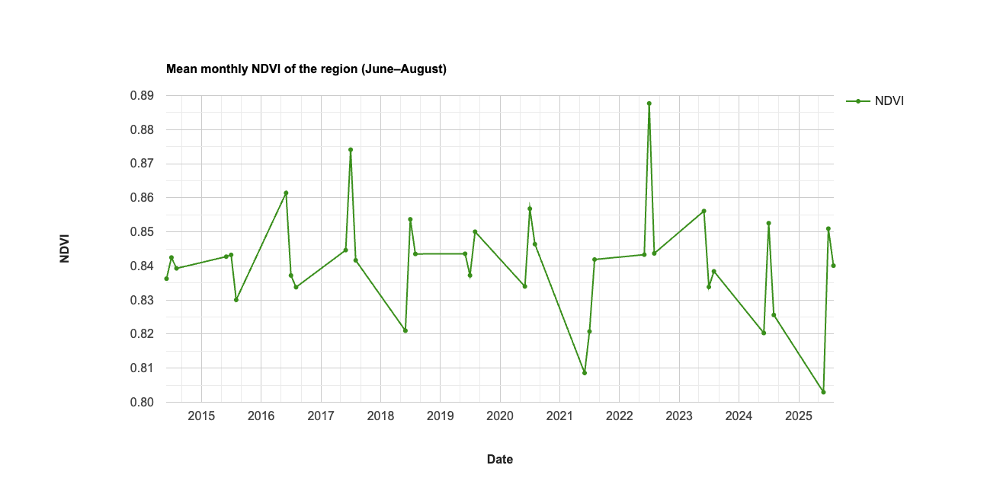

# GEE NDVI Workshop

*Français : [README.fr.md](README.fr.md)*

An introductory Google Earth Engine workshop: from a raw satellite image to a vegetation health map, with classification and time series. Ready-to-run script, interactive step-by-step guide (EN / FR / TR), and notes on how this version builds on the original workshop material.

**Interactive guide:** [English](docs/index.html) · [Français](docs/guide-fr.html) · [Türkçe](docs/guide-tr.html)  
*(publish with GitHub Pages — see below)*

## Contents

| Path | Description |
|---|---|
| [`scripts/ndvi_workshop.js`](scripts/ndvi_workshop.js) | Complete script — paste into the GEE Code Editor |
| [`docs/index.html`](docs/index.html) | Step-by-step guide with diagrams ([FR](docs/guide-fr.html), [TR](docs/guide-tr.html)) |
| [`docs/improvements.md`](docs/improvements.md) | What we improved vs the workshop version ([FR](docs/improvements.fr.md)) |
| [`images/`](images/) | Screenshots of the results (see gallery below) |

## Goals

1. Interact with the Google Earth Engine API in JavaScript.
2. Compute new bands (NDVI), classify an image and produce charts.
3. Understand what this data and these methods can and cannot do.

## Outline

Study area: three forested counties in the north-eastern United States (Franklin – Maine, Coos – New Hampshire, Essex – Vermont).

1. **Geometry**: a point, a polygon, and counties from `TIGER/2018/Counties`.
2. **Landsat 8** collection (C2 L2, 2014–2025) filtered by date and extent.
3. **Cloud and shadow mask** using bits 3 and 4 of `QA_PIXEL`.
4. **Scaling** of raw digital numbers (DN) to surface reflectance.
5. **NDVI** for every image, then a median composite.
6. **K-Means classification** (6 classes), renumbered by mean NDVI.
7. **Time series** of mean monthly summer NDVI (June–August) per county.
8. **Export** to Google Drive as GeoTIFF and Shapefile, then styling in QGIS.

## Results gallery

Outputs from running [`scripts/ndvi_workshop.js`](scripts/ndvi_workshop.js) in the GEE Code Editor.

**Study area** — Franklin (ME), Coos (NH), Essex (VT)

**True-colour Landsat composite** (collection / region)

**Median NDVI**

**K-Means classes** (0 = lowest NDVI → 5 = highest)

**Summer NDVI time series** (June–August, by county)

## Prerequisites

- A [Google Earth Engine](https://earthengine.google.com/) account linked to a Google Cloud project (free for non-commercial use).
- QGIS 3.x for the last part (optional).
- No prior JavaScript knowledge needed.

## How to use

1. Open the [Code Editor](https://code.earthengine.google.com/).
2. Paste the contents of `scripts/ndvi_workshop.js` and click **Run**.
3. For exports: open the **Tasks** tab and click **Run** on each task. Files go to the Drive folder `GEE_NDVI_workshop` (change it at the top of section 7 of the script).

> If an export fails with `Permission denied to create object in folder`, a read-only shared Drive folder has the same name. Choose a unique folder name.

## Key takeaways

- Level-2 products must be **scaled** before computing any index: NDVI on raw DN is biased by the −0.2 offset.
- A temporal **median** is more robust than a mean to leftover clouds.
- The choice of **reducer** changes the meaning: the mean describes a region's overall condition, the maximum only its single most extreme pixel.
- **K-Means** cluster numbers are arbitrary: order them before displaying them with an ordered palette.
- `Export.image` expects a single image. The `folder` parameter is a Drive folder **name**, not a path.

## Publishing the guide with GitHub Pages

In the repository: **Settings → Pages → Build and deployment**, source **Deploy from a branch**, branch `main`, folder `/docs`. The guide is then available at `https://geobytebrew.github.io/GEE_NDVI_workshop/`.

## Credits

Structure and original code: Women in GIS workshop "Intro to Google Earth Engine – Utilizing GEE to Analyze NDVI" (2026-10-15). Script refinements, interactive guide and documentation: Irem Cagbayir.

Data: USGS Landsat 8 Collection 2 Level-2; US Census Bureau TIGER/Line 2018, via Google Earth Engine.
